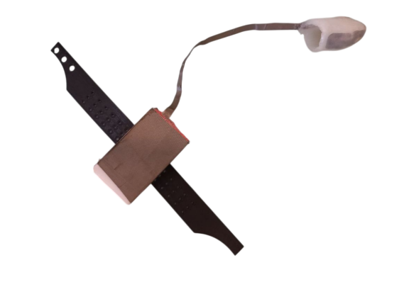
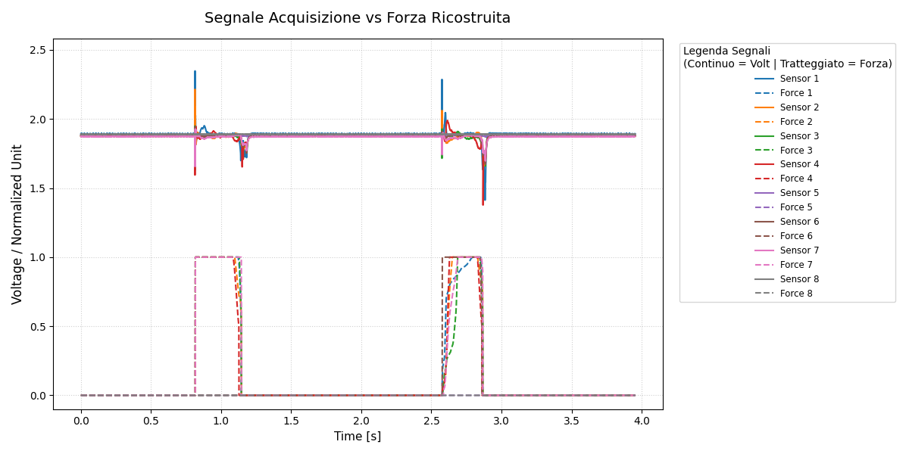
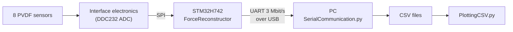
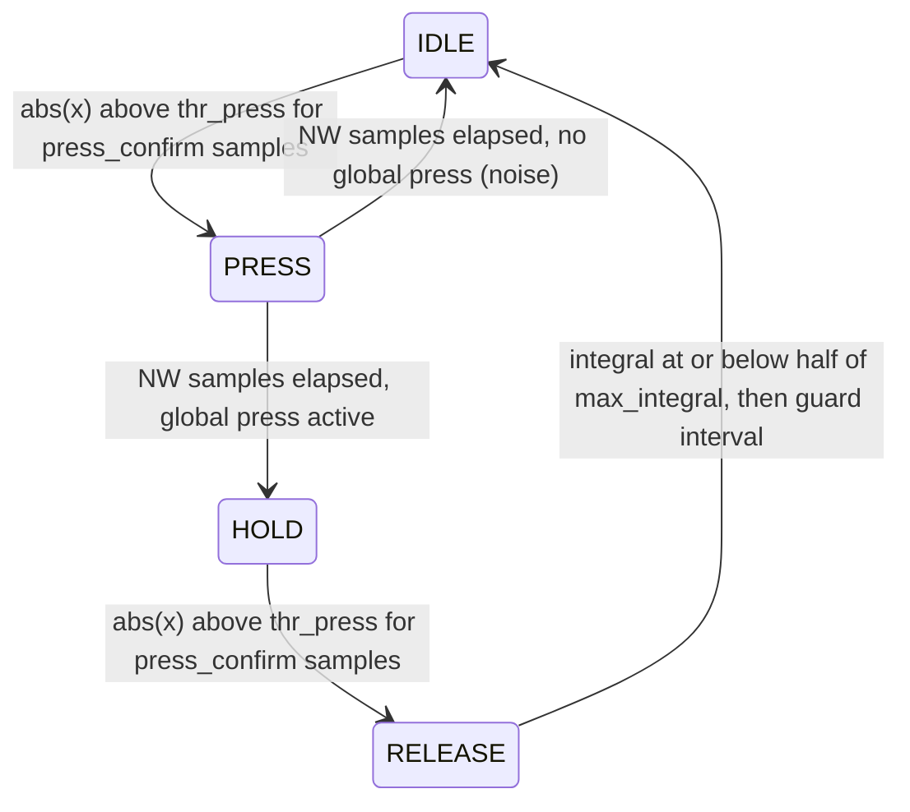

# PVDF Force Reconstruction

Real-time reconstruction of relative force from piezoelectric P(VDF-TrFE) tactile sensors, running on an STM32H742 microcontroller.

The sensors are embedded in a silicone finger with an artificial skin, developed at CosmicLab, University of Genoa. They respond to *changes* in pressure rather than to static force, so the raw signal alone can't tell you how hard something is being pressed. This project detects each contact, integrates the signal over the event, and outputs one force value per sensor in the range 0 to 1.

<p align="center">
  
</p>

The output is a **relative** value, normalized to the largest integral seen so far. It isn't calibrated in newtons.



*Double touch: sensor voltages (solid) and force reconstructed on the microcontroller (dashed).*

## Contents

- [How it works](#how-it-works)
- [Repository layout](#repository-layout)
- [Getting started](#getting-started)
- [The algorithm](#the-algorithm)
- [Reference](#reference): [UART commands](#uart-commands), [parameters](#reconstructor-parameters), [data packet](#data-packet), [CSV files](#csv-files), [TCP server](#tcp-server-protocol)
- [Known limitations](#known-limitations)
- [Credits and license](#credits-and-license)

## How it works



The sensors are sampled at 2 kHz. For each sample, the firmware updates the reconstructor and sends the PC one packet containing the raw channels and the force values.

The repository also keeps the earlier PC-side version of the algorithm. It's the same logic in Python, used during development before the port to C:

| | On-board (final system) | PC-side (development) |
|---|---|---|
| **Reconstructor** | `Firmware/Core/Src/ForceReconstructor.c` | `Scripts/force_reconstructor_Hannes.py` |
| **Runs on** | STM32H742, once per sample | PC, in blocks of samples |
| **Data path** | UART to `SerialCommunication.py` | TCP to `server_Hannes.py` |

## Repository layout

```
Documents/
  PetroccoTesi.pdf                 Thesis (in Italian): full system description and results
  Tesi/                            LaTeX source and figures
Firmware/                          STM32CubeIDE project "Read_user_defined_channels"
  Core/Src/ForceReconstructor.c    The algorithm in C
  Core/Src/main.c                  Acquisition, packet building, UART command parsing
  Core/Src/stm32h7xx_it.c          Interrupts, including the UART command dispatcher
  Drivers/                         ST HAL and CMSIS
  Read_user_defined_channels.ioc   STM32CubeMX configuration
LabView/
  pvdf_forcereconstructor.lvproj   LabVIEW project
  pvdf_forcereconstructor.vi       Main VI
  MessageType.ctl                  Type definition used by the VI
Scripts/
  SerialCommunication.py           Acquire data from the board and save it as CSV
  PlottingCSV.py                   Plot a saved acquisition
  force_reconstructor_Hannes.py    The algorithm in Python
  server_Hannes.py                 TCP server around the Python reconstructor
```

## Getting started

### 1. Flash the firmware

You need [STM32CubeIDE](https://www.st.com/en/development-tools/stm32cubeide.html) and an ST-LINK probe.

1. In STM32CubeIDE, choose **File > Import > General > Existing Projects into Workspace** and select the `Firmware/` folder.
2. Build the `Debug` configuration.
3. Create a debug configuration for the project (none is included in the repository) and run it to flash the board over SWD.

| | |
|---|---|
| **MCU** | STM32H742VGTx (LQFP100) |
| **Firmware package** | STM32Cube FW_H7 V1.12.1 |
| **Target** | Cortex-M7 with `fpv5-d16` hard float |
| **Serial link** | USART1, 3 Mbit/s, 8N1 |

> **Regenerating code from the `.ioc`:** STM32CubeMX only preserves code inside `USER CODE` blocks. Check that your changes are inside them before regenerating.

### 2. Acquire data

Connect the board over USB, then install the dependency and run the acquisition from the repository root:

```bash
pip install pyserial

# List the available serial ports
python -m serial.tools.list_ports

python Scripts/SerialCommunication.py --port COM3
```

Use your own port name, such as `/dev/ttyUSB0` on Linux. Don't touch the sensors for the first moments of the run, because the firmware recalibrates its noise thresholds at every start (about 175 ms with the default parameters).

The script records `N_SAMPLES` samples (4000 by default, set at the top of the file) and then stops the board.

| Option | Default | Meaning |
|---|---|---|
| `--port` | required | Serial port, such as `COM3` or `/dev/ttyUSB0` |
| `--output-dir` | `acquisizioni` | Folder where `Raw/` and `Volt/` are created |

Each run uses the next free number, so it never overwrites an earlier acquisition:

```
acquisizioni/Raw/acquisizione_python_raw(1).csv
acquisizioni/Volt/acquisizione_python(1).csv
```

### 3. Plot the results

```bash
pip install pandas numpy matplotlib

python Scripts/PlottingCSV.py --file "acquisizioni/Volt/acquisizione_python(1).csv"
```

Keep the quotes, because the filename contains parentheses. The script skips the first 100 samples and plots each sensor as a solid line with its force as a dashed line.

If you run the script cell by cell (`# %%`) in an editor, set the file through `DEFAULT_FILE` at the top of the script instead.

### Optional: Python reconstructor server

```bash
pip install numpy matplotlib

python Scripts/server_Hannes.py
```

The server waits for one client on `127.0.0.1:4000` and exits when that client disconnects. While it's running, type `t` and press Enter to recompute the thresholds, or `r` to reset everything. Edit `n_sensors` and the reconstructor parameters at the top of the script to match your client. See the [protocol](#tcp-server-protocol) for the data format.

### Optional: LabVIEW

Open `LabView/pvdf_forcereconstructor.lvproj` in LabVIEW 2023 or newer. The project depends on NI-VISA for the serial port. It includes a build specification that creates `pvdf_force_reconstructor.exe` in a `PVDF Force Reconstruction Application` folder, which git ignores.

LabVIEW was used for the first acquisitions. The final system doesn't need it, since `SerialCommunication.py` talks to the board directly.

### Optional: build the thesis

From `Documents/Tesi/`, using a full TeX distribution that includes Italian support for `babel`:

```bash
latexmk -pdf PetroccoTesi.tex
```

## The algorithm

This section describes what the code does. The thesis explains the reasoning in more depth, but [differs from the code](#known-limitations) on two details.

**Calibration** runs at every `start` and `r`, assuming no contact:

1. Discard the first `warmup_samples` samples.
2. Collect `Thr_samples` samples of background noise. For each sensor, compute:
   - the press threshold, `thr_press = press_sigma × σ`, where σ is the noise's sample standard deviation
   - the DC offset, the mean of the last `nSamples_adaptive_offset` samples

**Processing** then runs on every sample, for each sensor:

1. Low-pass filter the raw signal: `y(n) = α·x(n) + (1 − α)·y(n−1)`.
2. Subtract the DC offset to get `x`.
3. If the sensor is in its guard interval after a release, do nothing further for this sensor.
4. Update its state machine:



| State | What happens |
|---|---|
| **IDLE** | Waits for the signal to exceed the threshold. New presses are blocked once a global press is latched. |
| **PRESS** | `integral += abs(x)`, tracking `max_integral`. Lasts `NW` samples. |
| **HOLD** | `integral` stays constant, so the force holds its value. Waits for the release transient. |
| **RELEASE** | `integral -= abs(x)` until it falls to 50% of `max_integral`. The sensor then resets and waits `samples_after_release` samples. |

**Global logic** treats activity across the matrix as a single event:

- A global press becomes active once at least `min_press_sensors` sensors are in a press. This rejects noise on a single sensor.
- After `NW / 4` further samples, no new sensor can start a press. Later activity counts as part of the same event.
- The event ends once the released fraction of pressed sensors reaches `release_ratio`. All sensors then reset.

**Output:** while a global press is active, `force = integral / max_integral` for each sensor. Otherwise it's 0.

`max_integral` carries over between events and is only cleared by `start`, `r` and `rd`. So a first press reaches 1.0 immediately, while later, weaker presses settle below or climb more slowly towards the earlier maximum.

## Reference

### UART commands

Commands are plain text. The board recognises the end of a command when the line goes idle, so send each one as a single write.

| Command | Effect |
|---|---|
| `start` | Reset and recalibrate the reconstructor, then acquire all 64 channels |
| `start,1-8` | The same with selected channels. Ranges and single channels can be mixed, such as `start,1,3,5-8` |
| `stop` | Stop acquiring |
| `set,<param>,<value>` | Stop acquiring and set a [parameter](#reconstructor-parameters) |
| `r` | Stop acquiring and reset the reconstructor's state. Parameters are kept |
| `rd` | Stop acquiring and restore all parameters to their defaults |

After `start`, the board sends `OK\r\n` when its startup check of the acquisition hardware succeeds. The acquisition clock only starts after that, so if it never arrives, no data will follow.

`set`, `r` and `rd` all stop the acquisition, so send `start` again afterwards. Parameters are held in RAM and return to their defaults at power-up.

### Reconstructor parameters

| `set` name | Field | Default | Allowed | Meaning |
|---|---|---|---|---|
| `nw` | `NW` | 500 | ≥ 1 | Length of the press phase, in samples |
| `thr` | `Thr_samples` | 100 | 10–1500 | Samples used to learn the noise |
| `wup` | `warmup_samples` | 250 | 0–65535 | Samples discarded at startup |
| `pc` | `press_confirm` | 5 | ≥ 1 | Consecutive samples above threshold needed to change state |
| `ao` | `nSamples_adaptive_offset` | 50 | 1–50, at most `thr` | Samples used for the DC offset |
| `sar` | `samples_after_release` | 250 | 0–65535 | Guard interval after a release, in samples |
| `mp` | `min_press_sensors` | 2 | 1 to `ns` | Sensors needed for a global press |
| `ns` | `n_sensors` | 8 | 1–8 | Sensors processed |
| `sig` | `press_sigma` | 10.0 | ≥ 0 | Threshold, as a multiple of the noise σ |
| `a` | `alpha` | 0.3 | 0–1 | Low-pass filter coefficient |
| `rr` | `release_ratio` | 0.5 | 0–1 | Fraction of pressed sensors that must release to end the event |
| `s2n` | `signal2noise_ratio` | 10.0 | ≥ 0 | Stored, but not used by the algorithm |

Out-of-range values are clamped to the limits rather than rejected.

### Data packet

The board sends one packet per sample. With 8 channels and 8 sensors, each packet is 40 bytes.

| Offset | Size (bytes) | Field | Format |
|---|---|---|---|
| 0 | 3 | Header | `3C 3E 00` |
| 3 | 1 | `n_channels` | `uint8`, the number of selected channels (N) |
| 4 | 4 | `timestamp_us` | `uint32`, **little-endian**, microseconds |
| 8 | 2·N | Raw channels | 16-bit, **big-endian** |
| 8 + 2·N | 2·`n_sensors` | Force | `uint16`, **big-endian** |

To convert the values:

```python
volts = raw * 4.096 / 65535
force = force_raw / 65535  # 0.0 to 1.0
```

### CSV files

`SerialCommunication.py` writes tab-separated files with no header row, and each row has 17 columns:

| Column | `Raw/` file | `Volt/` file |
|---|---|---|
| 1 | Timestamp (µs) | Timestamp (µs) |
| 2–9 | ADC codes, sensors 1–8 | Volts, sensors 1–8 |
| 10–17 | Force, sensors 1–8 (0–1) | Force, sensors 1–8 (0–1) |

### TCP server protocol

All values are big-endian, and `n_sensors` is set in `server_Hannes.py` (16 by default).

**Client to server**, for each block of N samples:

| Size (bytes) | Content |
|---|---|
| 4 | N, as `uint32` |
| N × `n_sensors` × 8 | Samples as `float64`, one row per sample |

**Server to client:**

| Size (bytes) | Content |
|---|---|
| N × `n_sensors` × 8 | Force as `float64`, in the same layout |
| N × `n_sensors` × 3 | RGB colors as `uint8`, from matplotlib's `hot` colormap applied to the force |

The server's parameters are set in the script and differ from the firmware's defaults (for example, `NW=2000` and `Thr_samples=2000`).

## Known limitations

- **Not a calibrated force.** The output is relative to the largest integral since the last reset, so values from separate runs can't be compared directly.
- **Fixed to 8 sensors in the acquisition script.** `SerialCommunication.py` always sends `start,1-8` and discards any packet that doesn't have 8 channels. It also expects 8 force values, so don't lower `ns` when using it.
- **Channel selection doesn't affect the force.** The reconstructor always reads the first `n_sensors` SPI channels, whichever channels `start` selected for transmission.
- **Bandwidth.** Sending all 64 channels with 64 force values would need about 4.2 Mbit/s at 2 kHz, which is more than the 3 Mbit/s link. The firmware skips a sample if the previous packet is still being sent.
- **Unused parameter.** `signal2noise_ratio` is accepted but has no effect, in both the C and Python versions.
- **Differences from the thesis.** The thesis says the integral keeps accumulating during HOLD and that `max_integral` is the maximum within each event. In the code, integration stops at the end of PRESS and `max_integral` persists until a reset.

## Credits and license

Developed at **CosmicLab**, University of Genoa. The on-board implementation is the work of **Mattia Petrocco** for the thesis *"Implementazione su microcontrollore di un algoritmo per la ricostruzione in tempo reale della forza relativa da sensori piezoelettrici"* (academic year 2025/2026), supervised by Prof. Christian Gianoglio and Dr. Diana Makki.

This repository doesn't have a license yet. The ST HAL and CMSIS code in `Firmware/Drivers/` is covered by its own license files.
